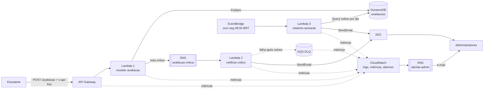

# Plataforma Serverless de Feedbacks de Cursos Online

Aplicação **serverless** em **Java 21** na **AWS** para receber avaliações (feedbacks) de estudantes,
notificar administradores sobre avaliações críticas e gerar um relatório semanal.

- [Visão geral](#1-visão-geral-e-modelo-de-cloud)
- [Arquitetura](#2-arquitetura)
- [Regras de negócio](#3-regras-de-negócio)
- [Funções serverless](#4-funções-serverless-documentação)
- [Segurança e governança](#5-segurança-e-governança-de-acesso)
- [Monitoramento](#6-monitoramento-e-alertas)
- [Deploy](#7-instruções-de-deploy)
- [Testando](#8-testando-a-aplicação)
- [Estrutura do repositório](#9-estrutura-do-repositório)
- [Custos e encerramento](#10-custos-e-encerramento)

---

## 1. Visão geral e modelo de cloud

**Modelo escolhido: Function as a Service (FaaS) / serverless na AWS**, com serviços gerenciados.

| Motivo | Justificativa |
|---|---|
| Pagamento por uso | Créditos de cloud limitados: sem tráfego, o custo é praticamente zero (Lambda, DynamoDB on-demand, API Gateway). |
| Escala automática | Picos de feedback (fim de módulo/curso) não exigem dimensionamento de servidores. |
| Menos operação | Sem SO, patches ou servidores para administrar; foco na regra de negócio. |
| Desacoplamento | Cada responsabilidade é uma função independente, ligada por eventos (SNS, EventBridge). |

### Componentes

| Componente | Serviço AWS | Papel |
|---|---|---|
| Entrada HTTP | **API Gateway (REST)** | Expõe `POST /avaliacao`, exige API key, aplica throttling e cota. |
| Função 1 | **Lambda** `receber-avaliacao` | Valida, classifica, persiste e publica críticas. |
| Função 2 | **Lambda** `notificar-critico` | Envia o e-mail de urgência. |
| Função 3 | **Lambda** `relatorio-semanal` | Consolida e envia o relatório semanal. |
| Banco de dados | **DynamoDB** | Armazena avaliações (criptografado, PITR, índice por dia). |
| Mensageria | **SNS** + **SQS (DLQ)** | Desacopla recebimento de notificação; DLQ guarda falhas de entrega. |
| E-mail | **SES** | Envio de e-mails de urgência, relatório e (via SNS) alarmes. |
| Agendamento | **EventBridge** | Dispara o relatório toda segunda-feira, 08:00 (Brasília). |
| Observabilidade | **CloudWatch** (logs, métricas, alarmes, dashboard) e **X-Ray** | Monitoramento e tracing. |
| Deploy | **AWS SAM** + **GitHub Actions (OIDC)** | Infraestrutura como código e deploy automatizado. |

---

## 2. Arquitetura



**Fluxo crítico:** a Lambda 1 grava a avaliação e, se a urgência for `ALTA`, publica no SNS e responde `201`
imediatamente. A Lambda 2 consome o evento de forma assíncrona; se o SES falhar, há retentativas e, por fim, a DLQ
(que possui alarme).

**Princípio de Responsabilidade Única:** cada função tem um único motivo para mudar.

| Função | Muda quando... | Não faz |
|---|---|---|
| `receber-avaliacao` | o contrato da API ou a validação mudam | enviar e-mail, gerar relatório |
| `notificar-critico` | o formato/canal da notificação muda | persistir, validar entrada |
| `relatorio-semanal` | métricas ou formato do relatório mudam | receber avaliações, notificar críticas |

O módulo `common` concentra apenas o que é compartilhado: modelo, regra de urgência e adaptadores (DynamoDB, SES).

---

## 3. Regras de negócio

A urgência não vem no payload; é **derivada da nota** (`ClassificadorUrgencia`):

| Nota | Urgência | Ação |
|---|---|---|
| 0 a 3 | `ALTA` (crítica) | Notifica administradores por e-mail |
| 4 a 6 | `MEDIA` | Apenas armazena |
| 7 a 10 | `BAIXA` | Apenas armazena |

- Datas são gravadas em **UTC (ISO-8601)**; e-mails e relatório exibem **horário de Brasília**.
- O endpoint é `POST /avaliacao` (sem acento na URL).
- O relatório cobre os **7 dias completos anteriores** à segunda-feira em que roda (segunda a domingo).

---

## 4. Funções serverless (documentação)

### 4.1 `receber-avaliacao`

| Item | Valor |
|---|---|
| Handler | `br.com.feedback.receber.ReceberAvaliacaoHandler::handleRequest` |
| Gatilho | API Gateway `POST /avaliacao` (exige header `x-api-key`) |
| Variáveis | `TABELA_AVALIACOES`, `TOPICO_CRITICO_ARN` |
| Permissões (IAM) | `dynamodb:PutItem` na tabela; `sns:Publish` no tópico de críticas |

**Requisição**
```json
{ "descricao": "As aulas do módulo 3 estão confusas", "nota": 2 }
```

**Respostas**

| Status | Quando | Corpo |
|---|---|---|
| `201` | Avaliação gravada | `{"id":"<uuid>","urgencia":"ALTA"}` |
| `400` | JSON inválido, `descricao` vazia/maior que 2000 caracteres, `nota` ausente, não inteira ou fora de 0-10 | `{"erro":"..."}` |
| `403` | API key ausente/inválida (API Gateway) | - |
| `429` | Limite de requisições excedido (API Gateway) | - |
| `500` | Falha de infraestrutura (dispara alarme) | - |

### 4.2 `notificar-critico`

| Item | Valor |
|---|---|
| Handler | `br.com.feedback.notificar.NotificarCriticoHandler::handleRequest` |
| Gatilho | SNS `feedback-avaliacao-critica-<ambiente>` |
| Variáveis | `EMAILS_ADMIN` (lista separada por vírgulas), `EMAIL_REMETENTE` |
| Permissões (IAM) | `ses:SendEmail` restrito ao remetente (`ses:FromAddress`); escrita na DLQ |
| Resiliência | 2 retentativas; depois DLQ SQS com alarme |

**E-mail enviado:** assunto `[URGENTE] Nova avaliação crítica (nota N)`; corpo com **Descrição**, **Urgência** e
**Data de envio**.

### 4.3 `relatorio-semanal`

| Item | Valor |
|---|---|
| Handler | `br.com.feedback.relatorio.RelatorioSemanalHandler::handleRequest` |
| Gatilho | EventBridge `cron(0 11 ? * MON *)` (08:00 de Brasília) |
| Variáveis | `TABELA_AVALIACOES`, `EMAILS_ADMIN`, `EMAIL_REMETENTE` |
| Permissões (IAM) | `dynamodb:Query` somente no índice `indice-dia-dataEnvio`; `ses:SendEmail` |

**Conteúdo do relatório (HTML + texto):** período, total e **média das notas**, **quantidade de avaliações por dia**,
**quantidade por urgência** e detalhamento (**descrição, urgência, data de envio**; limitado a 200 itens, com aviso
do excedente).

### 4.4 Modelo de dados (DynamoDB)

| Atributo | Tipo | Observação |
|---|---|---|
| `id` | S (PK) | UUID |
| `descricao` | S | texto do feedback |
| `nota` | N | 0 a 10 |
| `urgencia` | S | `ALTA`/`MEDIA`/`BAIXA` |
| `dataEnvio` | S | `yyyy-MM-ddTHH:mm:ss.SSSZ` (UTC) |
| `dia` | S | `yyyy-MM-dd` (UTC); partição do índice `indice-dia-dataEnvio` |

O relatório usa `Query` por dia no índice (sem `Scan`).

---

## 5. Segurança e governança de acesso

Resumo (detalhes e exemplos em [`docs/seguranca-governanca.md`](docs/seguranca-governanca.md)):

- **IAM com privilégio mínimo**: uma role por função, com somente as ações e recursos necessários.
- **Sem credenciais estáticas**: o pipeline usa **OIDC** do GitHub com uma role dedicada de deploy.
- **Criptografia**: em trânsito (HTTPS/TLS no API Gateway) e em repouso (DynamoDB com KMS, SNS com KMS, SQS SSE).
- **Proteção da API**: API key obrigatória, throttling (10 req/s, burst 20) e cota diária (5.000).
- **Dados do cliente**: logs estruturados **não registram a descrição** do feedback, somente id, nota e urgência;
  descrição é escapada no HTML do relatório (previne injeção).
- **Backup**: DynamoDB com Point-in-Time Recovery.
- **Governança**: contas com MFA, uso do IAM Identity Center em vez do usuário root, alerta de orçamento (AWS Budgets).
- **SES**: remetente restrito por `ses:FromAddress`.

---

## 6. Monitoramento e alertas

Tudo é criado pelo `template.yaml`.

| Recurso | Descrição |
|---|---|
| **Logs** | JSON estruturado, retenção de 30 dias por função (CloudWatch Logs). |
| **Dashboard** `feedback-<ambiente>` | Invocações, erros, duração p95 por função, requisições/4xx/5xx da API e mensagens na DLQ. |
| **Tracing** | X-Ray ativo nas funções e na API. |
| **Alarmes** | Erros de cada uma das 3 funções, 5xx na API e mensagens na DLQ. |
| **Notificação** | Todos os alarmes publicam em `feedback-alertas-admin-<ambiente>` (SNS), que envia **e-mail aos administradores**. |

> Após o primeiro deploy, o administrador recebe um e-mail do SNS e **precisa confirmar a assinatura** para
> receber os alertas.

Consulta útil (CloudWatch Logs Insights):
```
fields @timestamp, evento, urgencia, nota
| filter evento = "avaliacao_recebida"
| stats count() by urgencia
```

---

## 7. Instruções de deploy

### Pré-requisitos
- Conta AWS com permissão de deploy, [AWS CLI](https://aws.amazon.com/cli/) e [AWS SAM CLI](https://docs.aws.amazon.com/serverless-application-model/latest/developerguide/install-sam-cli.html)
- JDK 21 e Maven 3.9+

### Passo 1 - Verificar identidades no SES
No console do SES (mesma região do deploy), verifique o **e-mail remetente** e o **e-mail do administrador**.
Contas novas ficam em *sandbox*: é obrigatório verificar também os destinatários.

### Passo 2 - Build e testes
```bash
mvn clean verify
```
Gera `receber-avaliacao/target/receber-avaliacao.jar`, `notificar-critico/target/notificar-critico.jar` e
`relatorio-semanal/target/relatorio-semanal.jar`.

### Passo 3 - Deploy manual (primeira vez)
```bash
sam deploy --guided \
  --template-file template.yaml \
  --stack-name feedback-platform-dev \
  --capabilities CAPABILITY_IAM \
  --parameter-overrides Ambiente=dev EmailAdministrador=admin@exemplo.com EmailRemetente=no-reply@exemplo.com
```

### Passo 4 - Confirmar a assinatura de alertas
Abra o e-mail "AWS Notification - Subscription Confirmation" e confirme.

### Passo 5 - Obter URL e API key
```bash
aws cloudformation describe-stacks --stack-name feedback-platform-dev \
  --query "Stacks[0].Outputs[?OutputKey=='ApiUrl'].OutputValue" --output text

aws apigateway get-api-keys --include-values \
  --query "items[?contains(name,'feedback')].{nome:name,valor:value}"
```

### Deploy automatizado (GitHub Actions)
O workflow [`.github/workflows/deploy.yml`](.github/workflows/deploy.yml) roda a cada push na `main`
(build, testes, `sam deploy`). O workflow [`ci.yml`](.github/workflows/ci.yml) roda em PRs e valida o template.

Configure em *Settings > Secrets and variables > Actions*:

| Secret | Conteúdo |
|---|---|
| `AWS_DEPLOY_ROLE_ARN` | ARN da role de deploy assumida via OIDC (ver `docs/seguranca-governanca.md`) |
| `EMAIL_ADMINISTRADOR` | E-mail do administrador |
| `EMAIL_REMETENTE` | E-mail remetente verificado no SES |

Ajuste `AWS_REGION` e `AMBIENTE` no topo do `deploy.yml` se necessário.

---

## 8. Testando a aplicação

```bash
URL=<ApiUrl>
CHAVE=<API key>

# Crítica (nota <= 3): grava e dispara e-mail de urgência
./scripts/enviar-avaliacao.sh "$URL" "$CHAVE" "Aulas confusas e sem material" 2

# Normal: apenas grava
./scripts/enviar-avaliacao.sh "$URL" "$CHAVE" "Excelente curso" 9

# Inválida: retorna 400
./scripts/enviar-avaliacao.sh "$URL" "$CHAVE" "Nota inválida" 42
```

Disparar o relatório sem esperar segunda-feira (o relatório cobre os 7 dias completos anteriores ao "dia de referência").
Para a demonstração, use como referência o dia seguinte ao dia em que você enviou as avaliações de teste:
```bash
aws lambda invoke --function-name feedback-relatorio-semanal-dev \
  --payload '{"detail":{"referencia":"2026-11-10T11:00:00Z"}}' \
  --cli-binary-format raw-in-base64-out saida.json && cat saida.json
```
Sem o campo `detail.referencia`, a função usa a data atual (comportamento do agendamento semanal).

Testes automatizados: `mvn verify` (JUnit 5; cobrem regra de urgência, validação, cada handler e o cálculo do relatório).

---

## 9. Estrutura do repositório

```
.
├── pom.xml                      # POM pai (Java 21, BOMs, shade)
├── template.yaml                # Infra como código (AWS SAM)
├── common/                      # Domínio, regra de urgência, DynamoDB, SES, log JSON
├── receber-avaliacao/           # Função 1
├── notificar-critico/           # Função 2
├── relatorio-semanal/           # Função 3
├── .github/workflows/           # CI e deploy automatizado
├── docs/                        # Segurança/governança e roteiro do vídeo
└── scripts/enviar-avaliacao.sh  # Exemplo de chamada à API
```

Decisões técnicas: SnapStart + ARM64 (Graviton) + `url-connection-client` para reduzir cold start e custo;
log em JSON; clientes AWS criados no construtor (reutilizados entre invocações).

---

## 10. Custos e encerramento

Com créditos limitados, grave o vídeo de demonstração e depois remova tudo:

```bash
aws cloudformation delete-stack --stack-name feedback-platform-dev
```

O roteiro sugerido para o vídeo está em [`docs/roteiro-video.md`](docs/roteiro-video.md).
